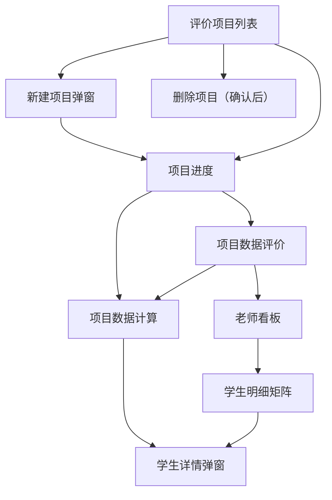

## 1. Product Overview
面向校内教务/年级组的“成绩增值评价”管理工具，以“评价项目”为载体完成 Excel 导入、模型计算与结果查看。
本次仅进行 UI/交互重构（信息架构、布局、组件一致性、可用性），不改变任何业务规则与接口。

## 2. Core Features

### 2.1 User Roles
| 角色 | 注册/登录方式 | 核心权限 |
|------|---------------|----------|
| 管理员 | 无需注册（单租户默认管理员视角） | 新建/删除项目；查看项目进度；查看数据计算与数据评价；老师看板与学生矩阵；导出 Excel；下载 PDF 报告 |

### 2.2 Feature Module
系统包含以下核心页面：
1. **评价项目列表**：项目列表（状态/进度/更新时间）、快速筛选、新建项目弹窗、删除项目。
2. **项目进度**：状态与进度展示、自动刷新、失败提示、进入详情/后台运行。
3. **项目数据计算**：条件筛选、分页与每页条数、明细表格、学生详情弹窗、导出 Excel。
4. **项目数据评价**：班级/老师 Tab、科目与对象筛选（chip）、图表展示、下钻到明细、导出 Excel。
5. **老师看板**：选择老师（chip）、总分老师/学科老师分支展示、班级明细表、跳转学生矩阵、下载 PDF。
6. **学生明细矩阵**：老师/科目/班级选择（chip）、指标多选、矩阵表（双层表头 sticky + 单元格着色）、学生详情弹窗、下载 PDF。

### 2.3 Page Details
| Page Name | Module Name | Feature description |
|-----------|-------------|---------------------|
| 评价项目列表 | 项目列表 | 展示项目ID/名称/入口/出口/状态/进度/更新时间；按状态决定“进度/查看”入口 |
| 评价项目列表 | 快速筛选 | 在前端对列表进行关键字过滤（名称/考试/状态） |
| 评价项目列表 | 新建项目弹窗 | 填写项目名称/入口考试/出口考试；上传 xlsx；提交后跳转项目进度页 |
| 评价项目列表 | 删除项目 | 仅在非 IMPORTING/CALCULATING 时允许；二次确认；删除后清理项目数据与上传文件 |
| 项目进度 | 进度展示 | 展示项目状态、进度百分比、message；轮询 `/projects/{id}/progress` 更新 |
| 项目进度 | 后台运行/进入详情 | 点击“后台运行”返回列表不影响任务；状态 COMPLETED 时显示“进入详情” |
| 项目数据计算 | 查询与分页 | 按姓名/班级/科目/教师筛选；支持输入 size；分页跳转保持查询条件 |
| 项目数据计算 | 明细表 & 学生弹窗 | 展示入口/本次分数与排名、Z分、Z赋分、差值、进退步；点击学生姓名弹窗展示该项目下全科明细（按进退步着色） |
| 项目数据计算 | 导出 | 按当前筛选条件导出 Excel（项目维度） |
| 项目数据评价 | Tab 与筛选 | 班级/老师两 Tab；科目默认“总分”；筛选使用 chip 平铺；对象列表随科目联动 |
| 项目数据评价 | 图表 & 列表 | 展示相对进步率、学业综合实力、保持/进步/退步图表；列表展示两套排名并支持下钻到数据计算页 |
| 项目数据评价 | 导出 | 导出班级/老师评价 Excel（多 Sheet 按科目顺序） |
| 老师看板 | 老师选择与分支 | 选择老师；若为“总分老师”则选择班级并展示总分+各科指标；否则选择科目并展示老师指标+任教班级指标 |
| 老师看板 | 下钻与 PDF | 从班级行进入学生矩阵；支持下载 teacher-subject/teacher-total PDF |
| 学生明细矩阵 | 范围选择 | 按老师与（科目/班级）确定数据范围：学科老师仅本科目；总分老师为总分+各科 |
| 学生明细矩阵 | 指标多选 & 表格 | 默认勾选：本次分数/进退步情况/进退步数值；双层表头 sticky；单元格按进退步着色 |
| 学生明细矩阵 | 学生弹窗 & PDF | 点击学生姓名弹窗展示项目内全科纵向明细；支持下载 PDF |

## 3. Core Process
管理员流程：进入评价项目列表 → 新建项目并上传 Excel → 跳转进度页观察导入/计算（可后台运行返回列表）→ 完成后进入详情（数据计算/数据评价）→ 在评价页或老师看板下钻查看学生范围 → 需要时导出 Excel 或下载 PDF → 对不再需要的项目执行删除。

